<p align="center">
  
</p>

<h1 align="center">react-native-skia-chart</h1>

<p align="center">
  Charts for Expo and React Native that are drawn on the GPU with Skia, animated on the UI thread, and easy for you or your coding agent to get right first time.
  <br />
  <a href="https://baraa-rasheed.github.io/react-native-skia-chart/"><b>Docs</b></a> ·
  <a href="https://baraa-rasheed.github.io/react-native-skia-chart/docs/agents">Agent guide</a> ·
  <a href="example">Example app</a>
</p>

---

<p align="center">
  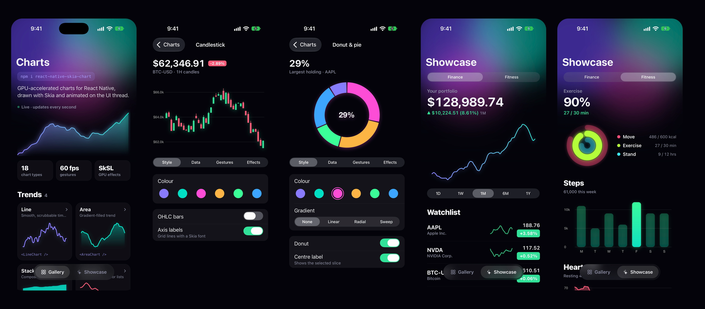
</p>

Most React Native chart libraries draw SVG through the bridge. This one draws every bar, slice and candle with `react-native-skia` 3.8 (Metal on iOS, Vulkan on Android). Scrubbing, selection and pinch-zoom run as Reanimated worklets. Your finger moves the cursor without a React re-render on each frame.

```tsx
import { LineChart } from 'react-native-skia-chart';

<LineChart
  data={prices}
  width={340}
  height={200}
  fill
  gradient={{ type: 'linear', colors: ['#5EE7DF', '#B490CA'] }}
  onScrub={(p) => p && setPrice(p.y)}
/>
```

## See it move

<table>
  <tr>
    <td align="center" width="25%">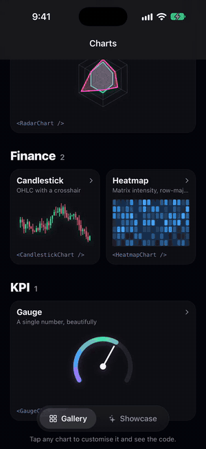<br /><sub>Scrub with a crosshair</sub></td>
    <td align="center" width="25%">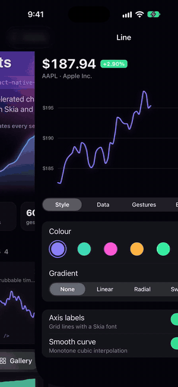<br /><sub>Gradients, glow, shaders, live data</sub></td>
    <td align="center" width="25%">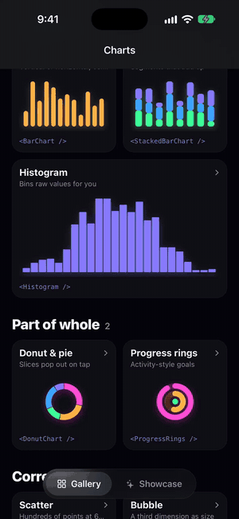<br /><sub>Tap to select</sub></td>
    <td align="center" width="25%">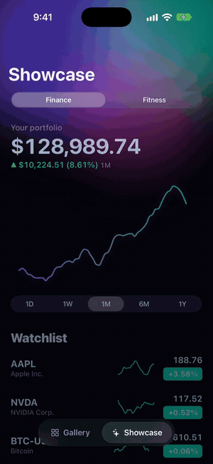<br /><sub>Real-world screens</sub></td>
  </tr>
</table>

## Charts

Every image below is a screenshot of the [example app](example). Click a chart to open its docs page.

<table>
  <tr>
    <td align="center" width="33%"><a href="https://baraa-rasheed.github.io/react-native-skia-chart/docs/charts/line">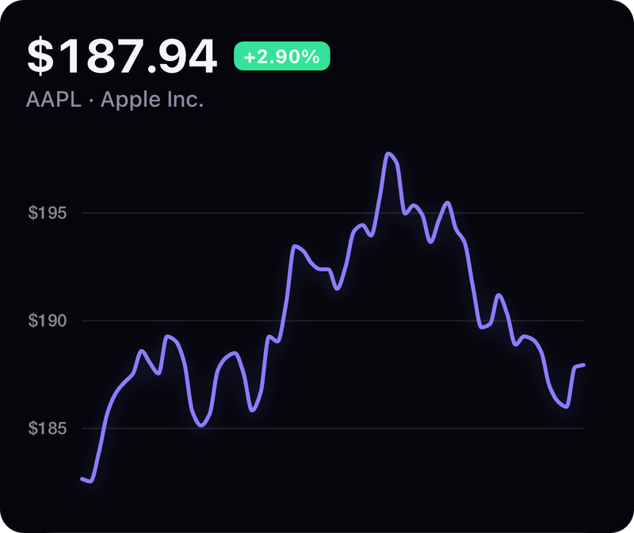</a><br /><b>Line</b><br /><sub><code>LineChart</code></sub></td>
    <td align="center" width="33%"><a href="https://baraa-rasheed.github.io/react-native-skia-chart/docs/charts/area">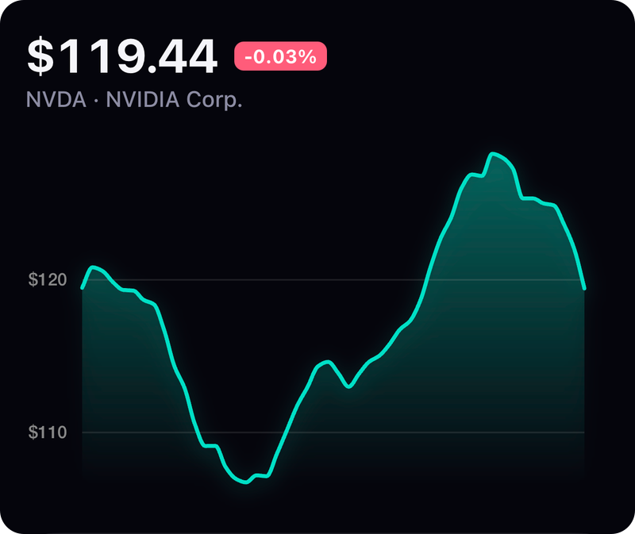</a><br /><b>Area &amp; Sparkline</b><br /><sub><code>AreaChart · Sparkline</code></sub></td>
    <td align="center" width="33%"><a href="https://baraa-rasheed.github.io/react-native-skia-chart/docs/charts/bar">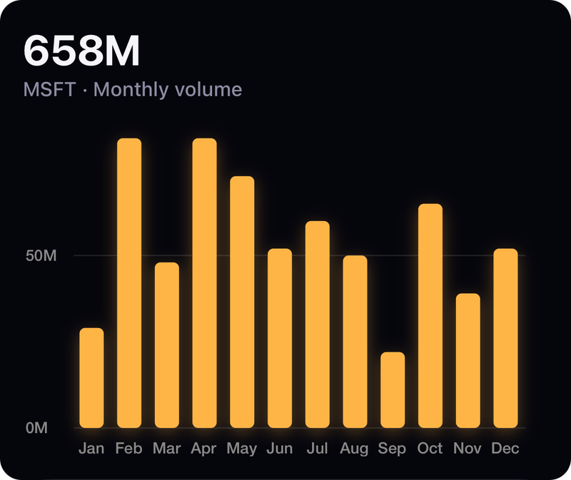</a><br /><b>Bar</b><br /><sub><code>BarChart</code></sub></td>
  </tr>
  <tr>
    <td align="center" width="33%"><a href="https://baraa-rasheed.github.io/react-native-skia-chart/docs/charts/stacked-bar">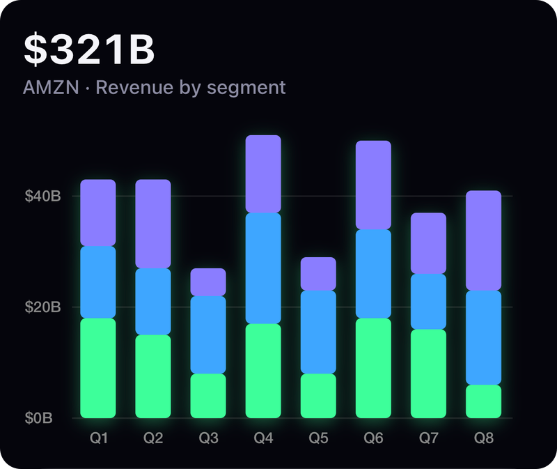</a><br /><b>Stacked bar</b><br /><sub><code>StackedBarChart</code></sub></td>
    <td align="center" width="33%"><a href="https://baraa-rasheed.github.io/react-native-skia-chart/docs/charts/histogram">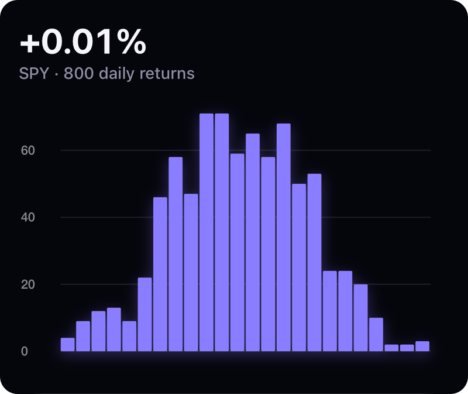</a><br /><b>Histogram</b><br /><sub><code>Histogram</code></sub></td>
    <td align="center" width="33%"><a href="https://baraa-rasheed.github.io/react-native-skia-chart/docs/charts/stacked-area">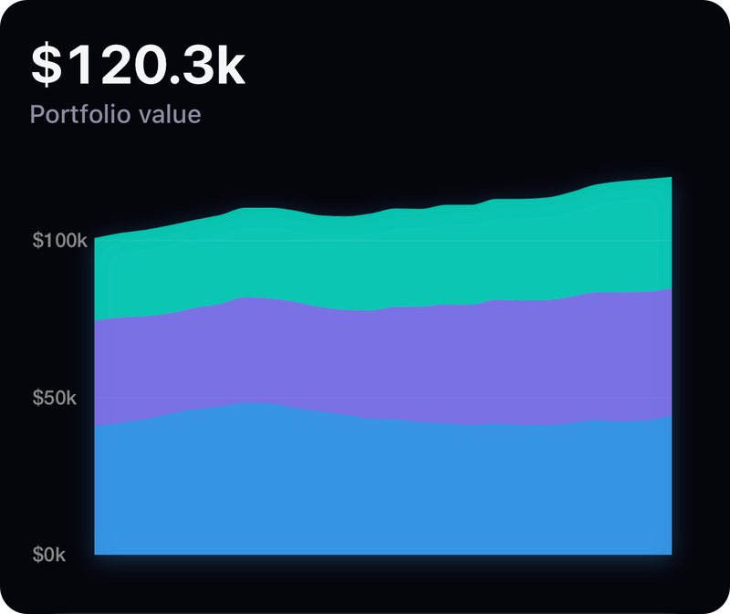</a><br /><b>Stacked area</b><br /><sub><code>StackedAreaChart</code></sub></td>
  </tr>
  <tr>
    <td align="center" width="33%"><a href="https://baraa-rasheed.github.io/react-native-skia-chart/docs/charts/pie-donut">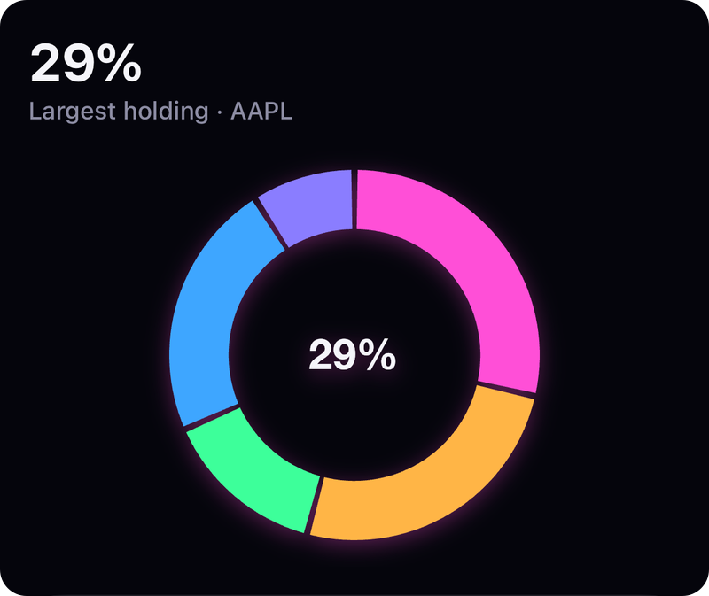</a><br /><b>Pie &amp; Donut</b><br /><sub><code>PieChart · DonutChart</code></sub></td>
    <td align="center" width="33%"><a href="https://baraa-rasheed.github.io/react-native-skia-chart/docs/charts/scatter">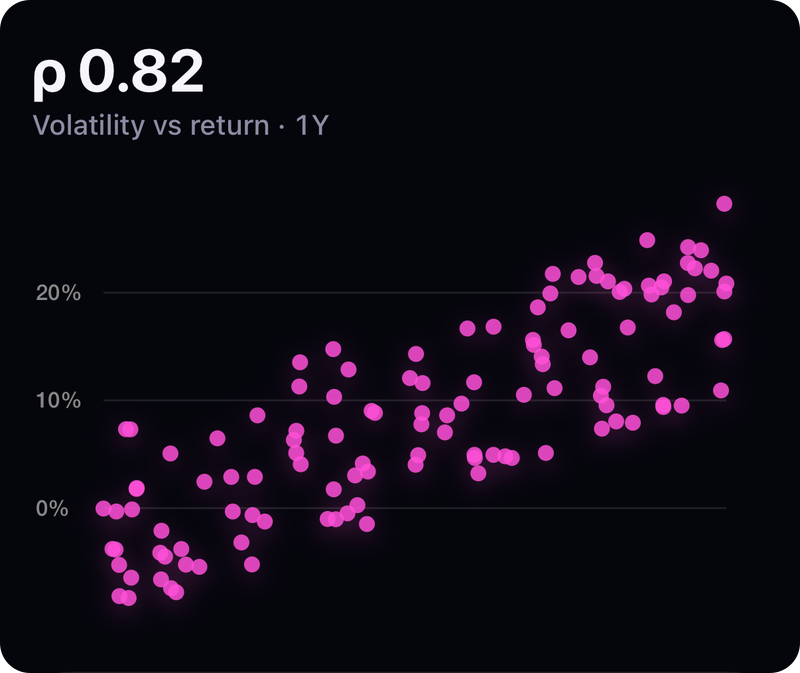</a><br /><b>Scatter</b><br /><sub><code>ScatterChart</code></sub></td>
    <td align="center" width="33%"><a href="https://baraa-rasheed.github.io/react-native-skia-chart/docs/charts/bubble">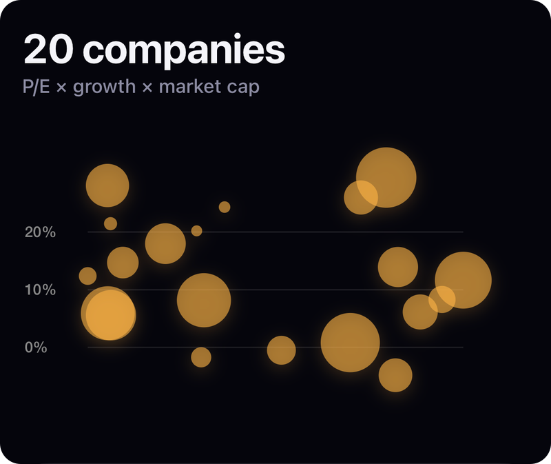</a><br /><b>Bubble</b><br /><sub><code>BubbleChart</code></sub></td>
  </tr>
  <tr>
    <td align="center" width="33%"><a href="https://baraa-rasheed.github.io/react-native-skia-chart/docs/charts/radar">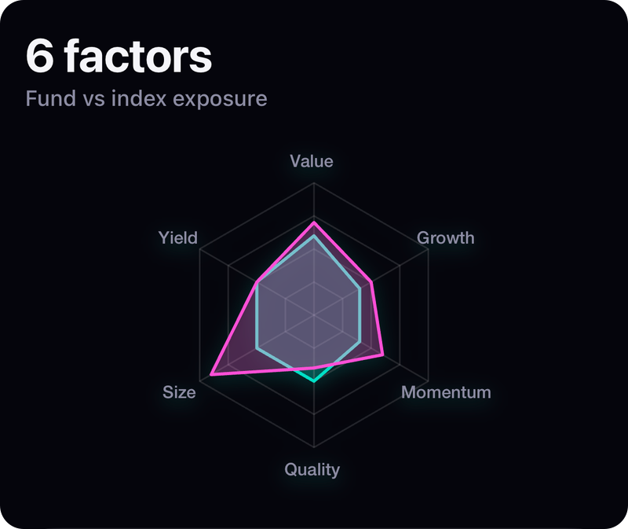</a><br /><b>Radar</b><br /><sub><code>RadarChart</code></sub></td>
    <td align="center" width="33%"><a href="https://baraa-rasheed.github.io/react-native-skia-chart/docs/charts/candlestick">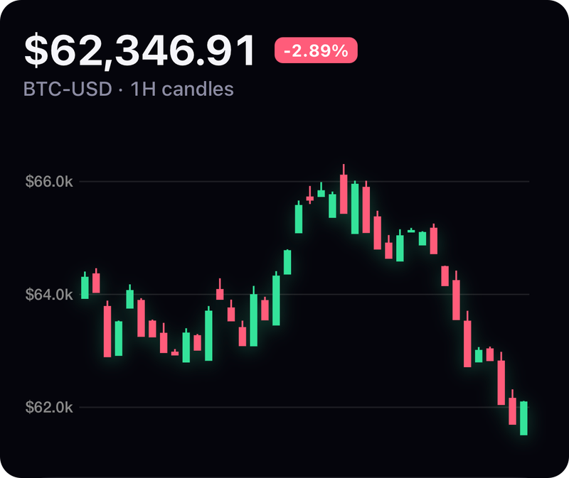</a><br /><b>Candlestick &amp; OHLC</b><br /><sub><code>CandlestickChart · OHLCChart</code></sub></td>
    <td align="center" width="33%"><a href="https://baraa-rasheed.github.io/react-native-skia-chart/docs/charts/heatmap">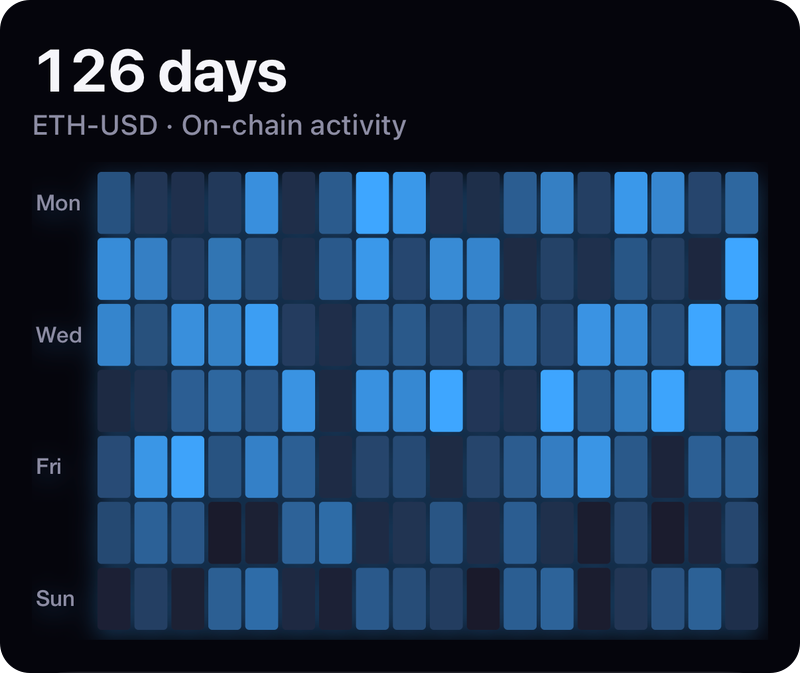</a><br /><b>Heatmap</b><br /><sub><code>HeatmapChart</code></sub></td>
  </tr>
  <tr>
    <td align="center" width="33%"><a href="https://baraa-rasheed.github.io/react-native-skia-chart/docs/charts/gauge">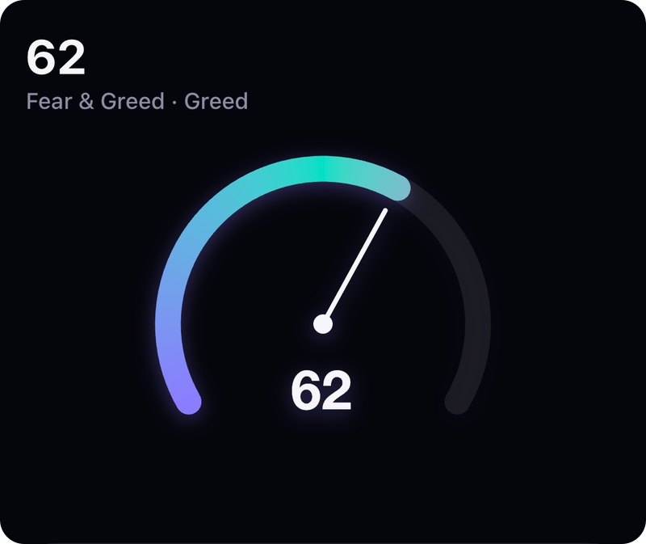</a><br /><b>Gauge</b><br /><sub><code>GaugeChart</code></sub></td>
    <td align="center" width="33%"><a href="https://baraa-rasheed.github.io/react-native-skia-chart/docs/charts/progress-rings">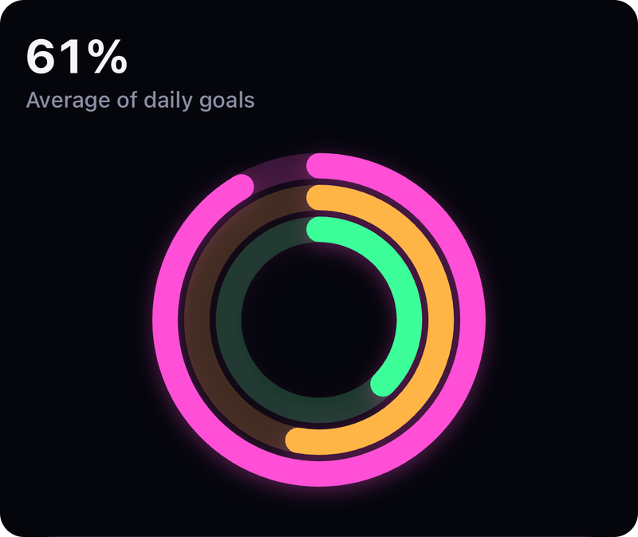</a><br /><b>Progress rings</b><br /><sub><code>ProgressRings · ProgressRing</code></sub></td>
  </tr>
</table>

## What you get

- **Touch:**
  - Scrub or use a crosshair on line, area and candle charts.
  - Tap or long-press to select a bar, slice, point, cell or ring.
  - Pinch, pan or double-tap to zoom any chart with axes.
  - [Interaction docs](https://baraa-rasheed.github.io/react-native-skia-chart/docs/interaction).
- **Looks:**
  - Linear, radial and sweep [gradients](https://baraa-rasheed.github.io/react-native-skia-chart/docs/gradients).
  - Shadows, glow, blur, blend modes, dashes and SkSL shaders through one [`effects`](https://baraa-rasheed.github.io/react-native-skia-chart/docs/effects) prop.
- **Same props everywhere:** every chart takes pixel `width`/`height`, plain-array data, and the same `gradient`, `effects` and `animation` props. Learn one chart and you know the rest.

## Works with coding agents

The API is small and regular on purpose, so an LLM can't easily guess it wrong.

- [`AGENTS.md`](AGENTS.md) ships in the npm package. Cursor, Claude Code, Copilot and others read it automatically. It covers which chart to pick, the rules, and one canonical snippet.
- [`llms.txt`](https://baraa-rasheed.github.io/react-native-skia-chart/llms.txt) and an [agent guide](https://baraa-rasheed.github.io/react-native-skia-chart/docs/agents) are published with the docs.
- [`example/recipes/agent-recipes.tsx`](example/recipes/agent-recipes.tsx) has one recipe per chart, compiled under strict TypeScript alongside the example app, so the snippets stay correct.

## Install

```sh
npx expo install react-native-skia-chart react-native-skia react-native-reanimated react-native-worklets react-native-gesture-handler
```

You need `react-native-skia` ≥ 3.8, Reanimated ≥ 4 and worklets ≥ 0.7. It needs a dev build (not Expo Go) and Android `minSdkVersion` 26.

## Example app

The example app is the quickest way to see what the library can do:

- **Gallery**: every chart type as a live preview, grouped by what it's for (trends, comparison, part of whole, correlation, finance, KPI).
- **Playground**: tap any chart to scrub, select and zoom it, and change colours, gradients, data, gestures and GPU effects live.
- **Showcase**: finance and fitness screens built from the same components.

```sh
cd example && npm install && npx expo run:ios   # or run:android
```

## License

MIT
